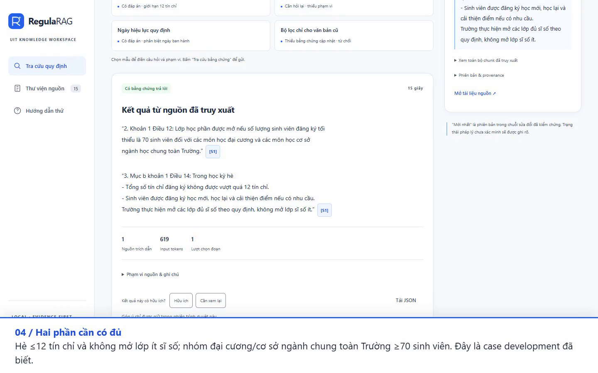

# RegulaRAG — tra cứu quy định UIT bằng nguồn có citation

[](https://github.com/vkhanh2802/RAGAskingRUle/actions/workflows/ci.yml)

**Từ câu hỏi tiếng Việt đến đoạn quy định có thể đối chiếu.** RegulaRAG giúp tìm
quy định UIT về tín chỉ, khóa luận, ngoại ngữ và các thủ tục học vụ trong một corpus
đã kiểm nguồn. Câu trả lời hiển thị nguyên văn, văn bản, trang PDF và citation mở
đúng bằng chứng; hệ thống có các trạng thái trả lời, hỏi lại và chưa đủ bằng chứng.

FastAPI phục vụ **API và native web UI chung một server**. E5-small + PostgreSQL
FTS/RRF + CPU cross-encoder truy xuất nguồn; Qwen GGUF chọn passage IDs, backend
dựng câu trả lời từ Unicode offsets/SHA đã xác thực. Đây là **local research demo**:
held-out đúng đủ ý **19/28**, task-support citations **29/108**, đúng từ chối **0/7**.

## Xem demo và đọc portfolio



- **[Video demo 4 phút, có chú thích tiếng Việt](docs/assets/regularag-demo.mp4)**:
  câu đơn giản → mở citation nguồn → hai điều khoản → không có bằng chứng →
  kiến trúc và benchmark. Tải MP4 để xem nếu trình xem Git không phát trực tiếp.
- [Slide overview offline](docs/portfolio.html), [kịch bản/chapter và cách quay lại](docs/portfolio-demo.md).
- [Phỏng vấn: overview 5 phút, deep dive 15–20 phút, quyết định/lỗi/CV](docs/interview.md).
- [Báo cáo kiểm chứng T5.4/M5](docs/portfolio-review.md).

Ảnh/video dùng các tình huống **development**, không phải một lần đo held-out mới.
Chỉ mở các đoạn trích ngắn đã có trong curated evidence; không phát hành PDF/toàn
văn OCR. Không hỗ trợ tư vấn pháp lý, dữ liệu sinh viên riêng, trường khác hoặc
tự xác nhận quy định còn hiệu lực. Mỗi câu hỏi độc lập; không có conversation memory.

## Kiến trúc và dữ liệu


- **Nguồn:** [Portal UIT](https://portal.uit.edu.vn/van-ban-bieu-mau?issuer=cap_truong),
  [manifest 15 PDF](data/manifests/documents.csv), [data/source review](docs/data-sources.md).
  Corpus hỗ trợ **15 ready documents / 307 chunks**; 188 trang gồm 103 approved,
  40 native và **45 excluded**, còn các vùng layout bị lược bỏ. `ready` là technical
  publication, không chứng nhận bao phủ toàn bộ hay hiệu lực pháp lý.
- **Ingestion:** PyMuPDF/Tesseract có điều kiện, review trang/layout theo hash,
  chunk cấu trúc, transaction/advisory lock, idempotent update/recovery.
- **Retrieval:** pgvector/E5 384 chiều + FTS `simple`/`unaccent`/`ts_rank_cd`;
  RRF, filter chung hai nhánh, quan hệ sửa đổi/latest có evidence, CPU reranker,
  reservation theo các nghĩa vụ cần trả lời. FTS này **không phải BM25**.
- **Generation:** context có budget → local `P#` → Qwen chọn IDs → backend kiểm
  range/hash/dependencies → nguyên văn `[S#]`; model không tự tạo URL hoặc số trang.
- **Vận hành:** server UUID/header/body → bounded JSON trace → CLI; Docker wheel,
  API/UI same-origin, PostgreSQL; CI mocked models và schema-isolated DB tests.

Chi tiết/thứ tự thực thi: [architecture](docs/architecture.md).
Checkpoint nguồn **2026-10-09**, không live-fetch Portal ở mỗi câu hỏi;
`legal_status` giữ `unknown` khi chưa có bằng chứng pháp lý hiện hành.

## Evaluation và kết quả đã đo

Frozen dataset **100 câu = 60 development + 40 test**, 72 source-bound spans /
49 chunks. Six categories: single-clause, multi-clause, temporal, no-answer,
clarification và adversarial. Review actual responses bởi assistant theo required
facts/actors/conditions/exceptions; không phải independent/blind human review hay
document-disjoint evaluation. Test chạy **một lượt sau release freeze** ngày
2026-10-11; hiện đã exposed. Model không nhận gold. CI pass không là answer accuracy.

| Metric và mẫu số | Development đã tuning | Held-out 40, một lượt |
|---|---:|---:|
| Đúng đủ ý trên câu có đáp án | 47/47 (100%) | **19/28 (67.86%)** |
| Required facts | 65/65 | **32/43 (74.42%)** |
| Task-support citation blocks | 60/60 | **29/108 (26.85%)** |
| Source-bound faithful quote blocks | 60/60 | 108/108 |
| Citation/offset/hash fidelity theo response | 60/60 | 40/40 |
| Support-chunk Recall@5 / MRR@10 | 1.0 / 1.0 | 1.0 / 0.9375 |
| Đúng từ chối câu không có đáp án | 8/8 | **0/7** |
| False rejection trên câu có đáp án | 0/47 | 2/28 |
| Required clarification axes | 12/12 | **0/20** |
| End-to-end p50 / p95 | 12.351 / 15.824 s | **21.552 / 32.707 s** |
| Local API spend | 0 VND | 0 VND |

**Trích đúng nguồn chưa đủ để trả lời đúng câu hỏi:** 108/108 quote blocks faithful
nhưng chỉ 29/108 hỗ trợ requested task; 79 blocks không hỗ trợ task. Claim unit là
atomic quoted block, không phải từng câu văn. Recall đo support chunks trên 28 câu
answerable, không chứng minh model đã chọn đủ ý. Combined correct cases là 19/40;
không dùng 47/47 development để quảng bá accuracy tổng quát.

Measurement: Windows 11 / i5-12450HX / ~12 GB RAM, CPU serialized concurrency 1,
Python 3.12.15, không warmup, low-memory model release/reload. p50/p95 là single-pass
mixed cold/warm; điện/compute/hosting chưa định giá. GPU RTX 3050 6 GB không dùng
trong benchmark. Video chạy Linux container ở snapshot sau instrumentation;
**không gán timings trong video cho benchmark M4**.

Artifacts: [development metrics](data/manifests/t4_4_development_metrics.json),
[held-out metrics](data/manifests/t4_4_held_out_metrics.json),
[release freeze](data/manifests/t4_4_release_freeze.json),
[methodology/final rubric/failures](docs/error-analysis-review.md).
T5.2 thêm instrumentation nên current source không thay thế exact M4 source fingerprint;
tái lập lịch sử cần measured source version cùng config/raw evidence.

### Lỗi còn lại và trade-offs

- **Unsupported questions T24–T30:** 7/7 vẫn trả các quote thật nhưng không có đáp án
  được chứng minh. No-answer control trong video chỉ minh họa một guard đã biết.
- **T31–T35:** thiếu các clarification axes cá nhân; **T10/13/14/15/22** thiếu nghĩa vụ
  liên kết; **T16/T20** false abstention; **T36/T38** chọn sai chủ đề dù gold ở ranked5.
  [21 failures được giữ](data/manifests/t4_4_held_out_failures.csv).
- **Đúng nguồn ↔ diễn đạt:** backend-bound quotes hạn chế bịa text/URL/pages nhưng
  câu trả lời dài và còn phụ thuộc lexical facets/LLM selection; chưa general entailment.
- **Quality ↔ CPU latency:** T4.3 RRF 36/47, CE 41/47 correct development, p95
  14.032 → 20.997 s trong core ablation; giữ CE/top4 vì quality. Top4 đạt cùng quality
  top8/12 ở run đã đo, không chứng minh causal speedup. [Ablation](docs/benchmark-ablation-review.md).
- **RAM ↔ reload:** small models/GGUF và release từng phase phù hợp máy hạn chế,
  đổi lại cold load và queue wait; API spend 0 VND không đồng nghĩa compute miễn phí.
- **Coverage ↔ kiểm chứng:** loại trang/layout chưa duyệt thay vì tự approve OCR confidence;
  hash/latest guards bảo vệ bound evidence, không tự xác nhận current legal status.

Các target held-out correctness ≥80%, task citation precision ≥90%, reject ≥85%,
p95 <10 s **chưa đạt**. Quality iteration tiếp theo cần development/evidence version
mới và test set độc lập mới; giữ nguyên gold/failures đã đo.

## Cấu hình và phần cứng

| Thành phần | Demo configuration |
|---|---|
| Python / dependencies | 3.12.15 / [70 pinned CPU packages](requirements.lock) |
| Embeddings | `intfloat/multilingual-e5-small`, 384 dims, CPU |
| Keyword / fusion | PostgreSQL 17 + pgvector 0.8.7; FTS + RRF k60, weights 1:1 |
| Reranker | `mmarco-mMiniLMv2-L12-H384-v1`, 20 candidates, CPU |
| Selector | Qwen2.5-1.5B GGUF Q4_K_M via llama.cpp, CPU 4 threads |
| Final config | [configs/rag/final.json](configs/rag/final.json): top4, input2304/output64, retry1 |
| UI/API | Native HTML/CSS/ES modules + FastAPI, one server, no frontend build |

Exact model revisions/policies được pin trong config. Compose chọn **final.json**;
host `Settings` mặc định vẫn baseline nếu không đặt `REGULARAG_RAG_CONFIG`.
Khuyến nghị máy ~12 GB RAM và Docker Linux/amd64 ~6 GB RAM như deployment đã kiểm;
cần thêm disk cho model cache/operator source files. [Trace/runtime](docs/observability-review.md).

## Chạy container local

Yêu cầu: DockerDesktop/Linuxcontainers (amd64), khoảng6GBRAM choDocker, đủdisk choimage/
modelcache, truy cậpPyPI/CPUwheel/HuggingFace khi bootstrap. LocalAPI publish **127.0.0.1:8001**.
DB data ởnamedvolume;weights/source/rawOCR không nằm trongimage/Git. Modelcache offline saubootstrap.

### 1. Image và database

```powershell
docker compose --profile app build api
docker compose up -d --wait db
docker compose --profile tools run --rm tools python scripts/migrate.py
```

Docker dùng Python3.12.15 vàsame70pinnedCPUpackages trongrequirements.lock; models tải riêng.
Image chứa installedwheel vàwebassets; khôngnpm/frontendbuild hoặcserver riêng.
Health kiểmdatabase/pgvector, **không** chứng minh model/corpus đãready.

### 2. Model cache — bước explicit

```powershell
docker compose --profile tools run --rm -e HF_HUB_OFFLINE=0 -e TRANSFORMERS_OFFLINE=0 tools python scripts/download_models.py
docker compose --profile tools run --rm tools python scripts/download_models.py --check-only
```

Script dùng exactrevisions trongconfigs/rag/final.json vàBGEtokenizerpin; không tải weights
trongdockerbuild/APIstartup. Cache defaultnamedvolume. Có thể đặt `REGULARAG_HF_CACHE`
trỏ tới HuggingFacehomecache đãcó, ví dụWindows`C:/Users/<user>/.cache/huggingface`.
Giữcache cấu trúc`hub/models--.../snapshots/<revision>/...`, không đặtfileweights tùy ý.

### 3. PDFs và approved publication — không tự approve

FullsourcePDFs/OCR/artifacts không được redistribute trongrepo/image. Để có corpus demo:

- Có15PDFs đúng`local_path`/SHA trong `data/manifests/documents.csv` ở `data/raw/uit/p0/`.
- Có reviewedartifact directories `data/processed/m2-publication/<document_id>/`
  vớimetadata/chunks/pages củasupportedM2scope; lấy từoperator đãreview hoặc thực hiện
  parse/OCR/post-edit/page/layoutreview theo [developmentguide](docs/development.md).
- Missing/corrupt/unapproved inputs bịchặn; không đổihash/gold hoặcapprovechỉ vìconfidence.
  Những inputs này làprerequisite rõ ràng, **freshclone chưa tự có RAGcorpus**.

```powershell
docker compose --profile tools run --rm tools python scripts/check_setup_inputs.py
docker compose --profile tools run --rm tools python scripts/index_baseline.py
```

Indexer đi quaatomicingestion lifecycle. Lượt đầu embed/index307approvedchunks/15documents;
lượt sau unchanged nếusource/config/hash/quality khớp. Không OCR lại hoặcre-index để làmbenchmarksđạt.
DB mới là một deployment riêng; originalfrozenM4measurement thuộcsourceversion/corpusrecordđãđo.

### 4. API/UI và checks

```powershell
docker compose --profile app up -d --wait api
```

Mở **http://127.0.0.1:8001/**, docs **http://127.0.0.1:8001/docs**.
Health **http://127.0.0.1:8001/health**; mỗiask có`request_id`/`X-Request-ID` đểinspectJSONtrace.

```powershell
# Trong Conda ragschool nếu chạy checks từhost:
python scripts/check_container.py --base-url http://127.0.0.1:8001
python scripts/check_container.py --base-url http://127.0.0.1:8001 --real --output-dir data/processed/<new-container-check> --summary data/manifests/<new-ID-only-check.json>
```

`--real` dùngdevelopmentcontrols hè12/GPA30/old-onlyguard, không dùngT01–T40heldout.
NativeWindowsdemo8000 vẫn được hướng dẫn ở [demo guide](docs/demo-guide.md).

## Cấu hình và dừng

Compose đọc `.env`/environment. Các giá trị mẫu là localdefaults; `.env` thật ngoàiGit.

- `REGULARAG_API_PORT`: default8001;localhostbinding.
- `POSTGRES_PORT`: default5432; đổi khi chạy một projectDB mới.
- `REGULARAG_CONTAINER_DATABASE_URL`: DSN bên trongcontainer, defaulthost`db`.
  Nếu đổiPGcredentials/database, cung cấpDSN tương ứng (URIencode nếu cần).
- `REGULARAG_HF_CACHE`: namedcache hoặchostHuggingFacehomepath.

```powershell
docker compose --profile app logs --no-color
docker compose --profile app down
```

Không thêm`--volumes` choDB/cachedemo nếu muốngiữ dữliệu. Logretention dooperator quản lý,
trace chỉboundedmetadata; rawresponses/models/OCR ngoàiGit theo`.gitignore`/`.dockerignore`.

## Tests và CI

Local checks trongConda `ragschool`:

```powershell
python -m ruff check .
python -m ruff format --check .
# Với PostgreSQL local của Compose từ Windows host:
$env:PGHOSTADDR = "127.0.0.1"
$env:PGCONNECT_TIMEOUT = "5"
$env:REGULARAG_RUN_DB_TESTS = "1"
python -m pytest
node --test tests/ui/contract.test.mjs
python scripts/check_environment.py
python -m pip check
```

IPv4 loopback và connect timeout tránh chờ vô hạn khi libpq/`localhost` trên
Windows không hoàn tất kết nối; credentials/database vẫn theo cấu hình operator.
Các biến này chỉ dành cho local DB endpoint trong ví dụ trên.

GitHubActions [CI workflow](.github/workflows/ci.yml): pinnedPython/packages/actions/PGimage,
Ruff/dependencychecks +fullunit/schema-isolatedDBtests +UIcontracts; **LLM/HFmodels mocked**,
downloadguard/offline/emptycache. Một job khácbuild/startpackagedUI/API trênfreshCIdatabase
với explicitmigrations, không tảimodelweights hoặcgọiheldout. Setup thủ công vàLinuxruntime
validation không bịgiấu dưới tuyênbố“một lệnh”.

Chi tiếtdata/setup/guards: [docs/development.md](docs/development.md).
T5.3packaging/freshsetup/hostedCIproof: [docs/container-deployment-review.md](docs/container-deployment-review.md).
Tiến độ vàbàn giao: [docs/progress.md](docs/progress.md), [docs/handoff.md](docs/handoff.md).
