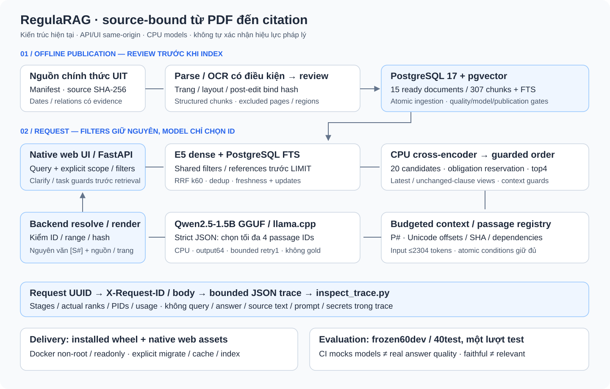

# Kiến trúc hiện tại của RegulaRAG

Snapshot T5.4; measured quality M4 giữ theo đúng source fingerprint đã freeze.
API/UI hiện dùng FastAPI + native HTML/CSS/ES modules; model inference CPU,
không frontend server riêng. Source provenance giữ từ PDF tới citation.

## 1. Offline publication và storage

1. Manifest URL/content SHA-256 của nguồn UIT; dates/cohort/relations chỉ lấy từ
   evidence đã review, stale hash không được nhận overlay.
2. PyMuPDF đọc native text; Tesseract OCR có điều kiện cho trang thiếu text/encoding
   lỗi. Page/layout/post-edit review bind source/cleaned-text hashes; confidence
   không tự approve. Hierarchy không nối qua trang excluded.
3. Structured chunking: BGE-M3 **tokenizer**, target700/hard800/overlap100; giữ
   chapter/article/clause/source spans, Unicode text/hash và PDF page mapping.
4. Atomic ingestion theo document, advisory lock và transaction publication;
   `pending/processing/ready/failed` khác publication status. Failed update giữ
   old chunks để audit nhưng chặn search; retry/config/hash changes có run riêng.
5. PostgreSQL `documents`, `chunks`, `ingestion_runs`, vector384/GIN FTS. Search
   yêu cầu publication/ingestion ready, đúng model fingerprint/quality/scope.

Corpus M2 **15 ready / 307 unique chunks / 307 FTS**; 188 pages gồm 103 approved,
40 native, 45 excluded, còn omitted regions trên mixed pages. Raw PDF/full OCR/
approved fulltext/model weights không nằm trong Git/image. Review evidence và
coverage: [data sources](data-sources.md), [M2 report](m2-corpus-review.md).

`ready` là technical publication. `legal_status=unknown` khi chưa xác minh; checkpoint
Portal/PDF 2026-10-09 không đồng nghĩa live/current verification mỗi request.

## 2. Một request thực thi thế nào

### A. Transport và phạm vi

- ASGI middleware sinh server UUID, `X-Request-ID` và body `request_id`; ContextVar
  truyền sang sync workers, isolate concurrent requests; inference queue serialized.
- `POST /api/v1/ask` nhận question/top_k/retrieval_mode/typed filters/optional scope.
  Backend hỏi lại nếu declared scope thiếu/mâu thuẫn; task/institution/instruction
  guards có thể abstain trước model. Không rewrite query hoặc conversation memory.
- Caller filters AND giữa fields/OR trong lists; dates/cohort phải có evidence.
  `study_progress` là explicit elapsed mainsemesters, strict int0–40, không suy từ
  cohort/issued year. None vắng mặt khỏi serialization của frozen dataset.

### B. Retrieve, order và context

1. **Dense:** E5-small query/passage prefixes, 384dims CPU; window512/overlap32/
   mean pooling cho text dài. Dense cosine ≥0.55.
2. **Keyword:** PostgreSQL `simple`/`unaccent`, `ts_rank_cd`, GIN; **không BM25**.
   Shared filters/explicit document references áp trên cả hai nhánh trước LIMIT.
3. **Fusion:** RRF k60/weights1:1, candidate pool20, dedup chunk ID;
   branch/raw/rank scores giữ riêng, không coi RRF/logit là confidence.
4. **Focus/freshness:** verified source-bound family/affected-clause witnesses,
   update companions; old affected clauses không trở lại khi latest bị callerfilter
   loại. Unchanged 79014.1(a) có hash-bound view dù 1393 sửa14.1(b).
5. **Cross-encoder:** pinned mmarco-mMiniLMv2 CPU batch1/threads2,
   window512/overlap32/max raw logit. Sau đó guarded obligation reservation/order,
   effective top4; support providers chỉ từ cùng eligible pool/callerfilters.
6. **Context/guards:** reserve required update evidence và check hash/instruction/
   applicability; budget/context chọn approved bound passages. Source IDs `S#`
   gán theo actual context, passage IDs `P#` theo request-local registry.

Latest là trong **verified family + corpus + request scope/cutoff**, không phải
global-newest hoặc chứng nhận còn hiệu lực. `as_of` là historical cutoff explicit.
Top4 là retrieval selection, context ceiling6; không khẳng định mọi request có6chunks.
Recall/MRR finalv3 đo **CE + guarded reservation**, không pure-CE-only gain.

### C. Selector và backend-derived answer

- Context input ≤2304 tokens; atomic conditions và date/signature dependencies
  không cắt giữa block để làm vừa budget; tối đa8 candidate passages.
- Qwen2.5-1.5B-Instruct GGUF Q4_K_M qua llama.cpp **chỉ chọn `P#`** theo strictJSON/
  enum, max4selected, output64tokens, bounded retry1. Không nhận reference/gold,
  không tự sinh final prose/URL/page/source ID.
- `resolve_passages` kiểm registry membership/duplicates/Unicode range/text SHA/
  allowed unchanged views/required dependencies/complete lexical supports.
- Backend dựng `“verbatim passage” [S#]` và metadata từ stored sources. Response
  `evidence_passages` là actual text/offset/hash/cited/dependencies;
  `sources.excerpt` vẫn full approved chunk để operator đối chiếu.
- Trạng thái API: `answered`, `insufficient_evidence`, `needs_clarification`.
  Low-memory release/reload E5/CE/LLM giữa phases phù hợp RAM, đổi lại cold latency.

**Ranh giới:** lexical facets/support contracts chưa general entailment. Range/SHA/
source validity bảo đảm quote thật, không chứng minh đủ requested facts/relevance.
Xem [citation](passage-citation-review.md), [scope](clarification-abstention-review.md),
[GPA fix](gpa-credit-freshness-review.md), [M4 evidence](error-analysis-review.md).

## 3. UI, tracing và deployment

| Thành phần | Hiện thực / ranh giới |
|---|---|
| Native UI | FastAPI `/` + `/assets`, same-origin; safe text nodes/HTTP URLs, actual citations/source pages, scope/filter controls |
| Session | Feedback/JSON export local browser session; chưa feedback DB persistence, không account |
| Observability | `pipeline-trace-v1`: UUID/span/stage/ranks/chunk/PID/usage/cost metadata; no query/answer/source/prompt/secrets |
| Bounds | 64spans/100chunkrows/snapshot/16passages/160char attributes + omitted counts; parent durations inclusive |
| Inspection | `scripts/inspect_trace.py` exact one UUID; trace flag off vẫn trả request ID; sink failures không đổi answer |
| Container | Installed wheel + web assets, Python3.12.15/70 pins, UID10001/readonly/tmpfs, one API worker |
| Bootstrap | Explicit migration/model-cache download/check/operator-approved inputs/index; API startup không tự approve/index |
| Database | Pinned PostgreSQL17/pgvector0.8.7 image; migrations001–006, persistent volume |
| CI | Full unit/schema-isolated DB + UI contracts; models mocked/offline/downloadguard; second job build/migrate/model-free packaged startup |

Local API/UI **127.0.0.1:8001**; host Conda alternative8000. Langfuse, central trace
storage/rotation, multi-turn memory và general entailment chưa triển khai.
[Runbook](../README.md), [trace report](observability-review.md),
[container/hosted CI proof](container-deployment-review.md).

## 4. Config và evaluation versioning

- [final.json](../configs/rag/final.json) là Compose demo config:
  `rag-obligation-support-v3` / `clause-scoped-v2` / `guarded-obligations-v2` /
  `bound-obligation-selection-v4`. Host Settings default baseline nếu chưa override.
- Pins: E5 revision`614241f…`; CE`1427fd6…`; Qwen`91cad51…`;
  BGE tokenizer`5617a9f…`. Full revisions trong versioned configs/model bootstrap.
- Dataset frozen100:60development/40test,72spans/49chunks. Evaluator
  `source-bound-evaluation-v1`: support-chunk recall/MRR, complete answer facts,
  task-support citation blocks, faithful quote/fidelity, abstention/clarification,
  actual timing/usage; semantic assistant review response-SHA-bound.
- M4 freeze trước one-time40 inference; **19/28correct,29/108taskcites,0/7reject**.
  Source code fingerprint và gold/corpus/config/review hashes không được đổi để
  đạt score; current instrumentation là source version mới sau measured snapshot.
- Test40 đã exposed; future prospective claims cần độc lập test/evidence version mới.

Repo source map: `ingestion/`, `db/`, `retrieval/`, `generation/`, `api/`,
`core/`, `evaluation/`, `web/` dưới `src/regularag/`; scripts vận hành/evaluation
riêng. Video/portfolio là presentation artifacts, không làm thay đổi inference code.

## 5. Ba quyết định chính

1. **PostgreSQL + pgvector/FTS:** metadata/filter/transactions nhất quán, dễ audit;
   không mặc định hybrid tốt hơn từng nhánh, chất lượng phải đo ablation.
2. **LLM selector + backend-bound citations:** chống invented text/URL/page ở
   điểm render; trade-off long quotes và remaining task-relevance failures.
3. **Small pinned CPU models + staged release:** chạy local API spend0 trên máy
   ~12GB RAM; reranker/reload tăng latency, compute/electricity chưa định giá.

Chi tiết quyết định/ba lỗi thật/failure còn lại: [interview](interview.md).
